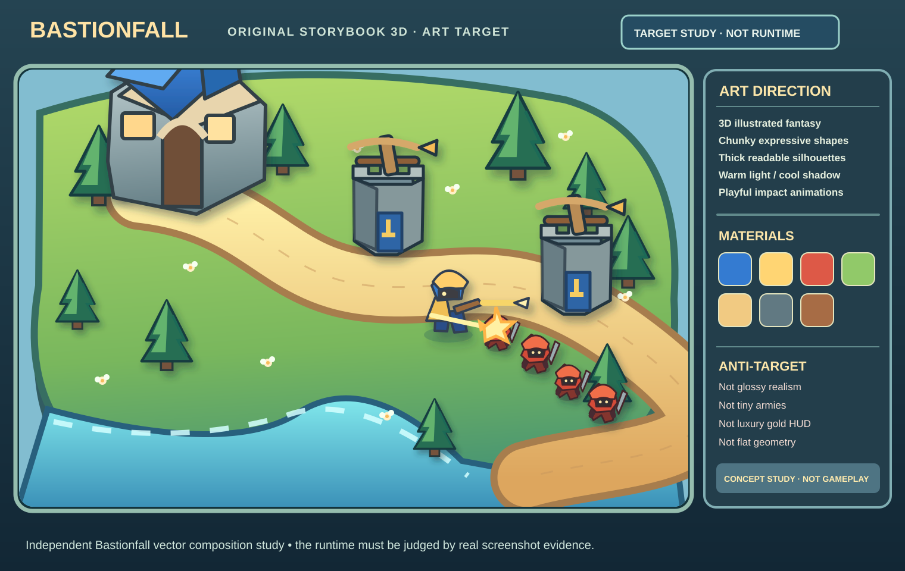

# Visual references — original Bastionfall art direction

**Latest REAL in-engine two-wave siege evidence, 2026-11-11:** [GitHub Chrome 16:9/9:16 screenshots, authentic core HP 300→296](https://github.com/lordfireballzmc/BrowserGame/actions/runs/42939029548/artifacts/13819453304) in [F3.04b review](../37_F304B_REAL_TWO_WAVE_CORE_DEFENSE_REVIEW.md). These are true active Three.js Warden-vs-red-raider game captures, not composited target art. All imported CC0 rigged and environment assets are loaded in both capture JSONs. Permanent review describes actual remaining VQ failures; Actions ZIP expires after 21 days. No claim that the two-wave still is full 10-wave completion, premium user-approved sculpting or a real-phone FPS benchmark.

**Authoritative decision:** `docs/20_VISUAL_NORTH_STAR.md`.  

**Mandatory render-quality and animation companion:** [VQ visual fidelity & fluidity directive](../29_VISUAL_FIDELITY_AND_FLUIDITY_DIRECTIVE.md). The version-controlled SVG below is aspirational only; it does not justify accepting an upscaled 720p game or low-quality primitive rendering. Latest intent: maximal original illustrated 3D clarity, sculpted detail, professional fluid movement and real engine capture verification.

**User preference:**
**Latest ACTUAL gameplay source, not a concept render:** [VQ.02d original grass/bush/wildflower before-after in real landscape and portrait](../35_VQ02D_ILLUSTRATED_GROUNDCOVER_REVIEW.md) with [exact Chrome screenshot ZIP](https://github.com/lordfireballzmc/BrowserGame/actions/runs/42926944486/artifacts/13814936415) (Actions artifact 21-day retention). The full visual judgment and source SHA/CC0 facts are permanently retained in the review; no claim that the 3D kit is final original-exclusive art.

 lively, hand-illustrated tower-defense personality comparable in *general qualities* to Kingdom Rush, **translated into original actual 3D meshes and animation**; explicitly **not** the glossy, monumental, small-figure look associated with Rise of Kingdoms. Neither game's proprietary pictures, characters, UI or branding are to be included in Bastionfall output.

## Version-controlled visual anchor

- [Open original composition study](target-illustrated-3d-composition.svg): scalable SVG showing proposed battlefield hierarchy, visual material palette, character-scale readability, chunky keep/tower silhouettes, friendly Warden, compact raider column, purpose-driven bolt feedback and a restrained fantasy UI. This image is **concept illustration**, not a screenshot of shipped graphics.
- [Read the visual north star](../20_VISUAL_NORTH_STAR.md): the binding art-quality and anti-target requirements, including design acceptance, motion, materials and mobile viewport testing.
- [Read the art/animation specification](../03_ART_AND_ANIMATION_BIBLE.md): existing semantic color tokens, world bounds, original character and asset contracts; the newer north star controls **style interpretation** when these specs conflict.
- [Read the visual-review log](../21_VISUAL_REVIEW_HISTORY.md): why the previous polished mockup direction was rejected and the outstanding visual gap in the real game.
- [Regenerate original image studies](GENERATIVE_MOCKUP_PROMPTS.md): carefully controlled prompts for 16:9 action, 9:16 gameplay and unit/art sheet variations (avoid direct copying of any third-party screenshots).

## Provenance and truthfulness
The mockup sheets generated during this ChatGPT discussion are **original AI concept experiments**, not in-engine renderings. They were used to establish art direction; **only the SVG in this directory is currently committed as a visual image asset**. Do not claim that absent concept PNGs are checked into GitHub, or confuse the picture here with the existing WebGL2 build.

The source user-provided third-party advertisement screenshot and all outside Kingdom Rush/Rise of Kingdoms screenshots are **excluded from the repository** to reduce copyright/rights risk. A generic style target is not a license to trace characters, copy game UI icons, clone maps, or use external textures.

## Mandatory image review for future sessions
Compare each new real runtime screenshot against the SVG plus north-star rules at the *same displayed* scale, in both landscape and portrait:
1. **Readability** — identify the hero, Runner and Scrapper at gameplay zoom without extra labels.
2. **Weight** — every tower/keep/hero visibly occupies 3D volume, has soft contact shadows, and does not float above terrain.
3. **Shape character** — broad curved/rounded/tapered masses and big expressive prop proportions, not photoreal armor or cone/polygon soup.
4. **Painted light** — warm focal planes, cool shadow planes, saturated but coherent color ramps, avoid glossy chrome or high-frequency material noise.
5. **Animation** — actual articulated leg/arm foot contact and recoil, not 2-frame bob/whole-mesh elastic scaling called a walk cycle.
6. **Combat FX** — readable projectile, short visible hit and VFX decay, meaningful damage feedback without hiding the road.
7. **UI** — economical illustrated controls, not giant gold-trimmed resource counters.
8. **Pixel fidelity** — record displayed CSS pixel dimensions, actual backing/WebGL buffer pixels, DPR and graphics tier; detect softness from upscaling and AA blur.
9. **Animation** — inspect actual frame sequences of gait, attack release/impact, recoil/recovery and motion smoothing, not just still frames.
10. **Truth** — cite a verified GitHub Actions screenshot artifact and state that a screenshot does not prove FPS or touch responsiveness.

Keep failing qualities in `docs/21_VISUAL_REVIEW_HISTORY.md` and refine the actual runtime; creating a more beautiful new concept image alone is not progress toward a production screenshot.
